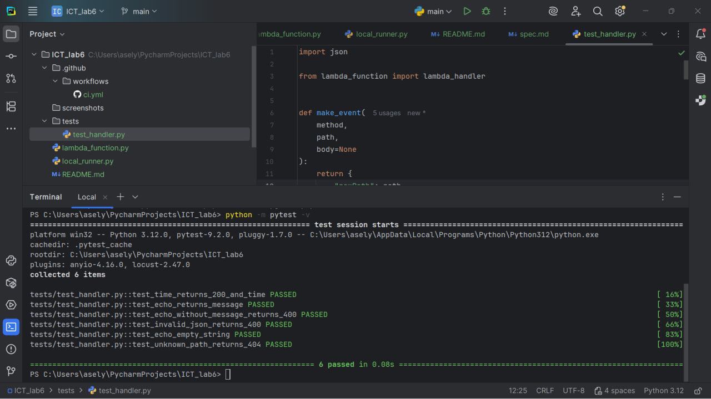
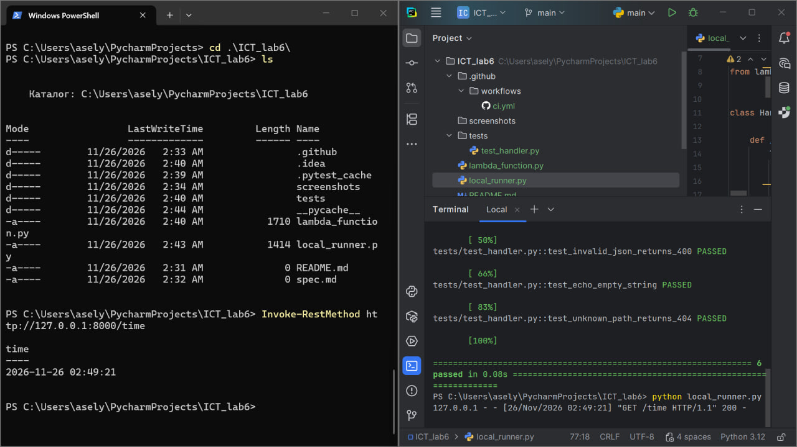
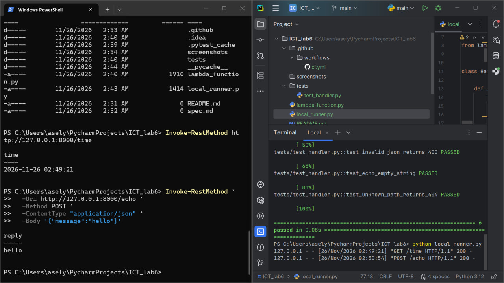
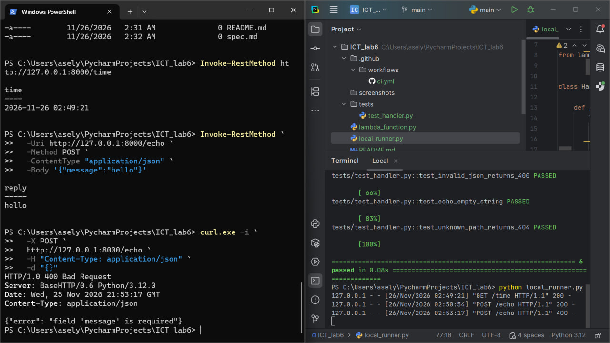
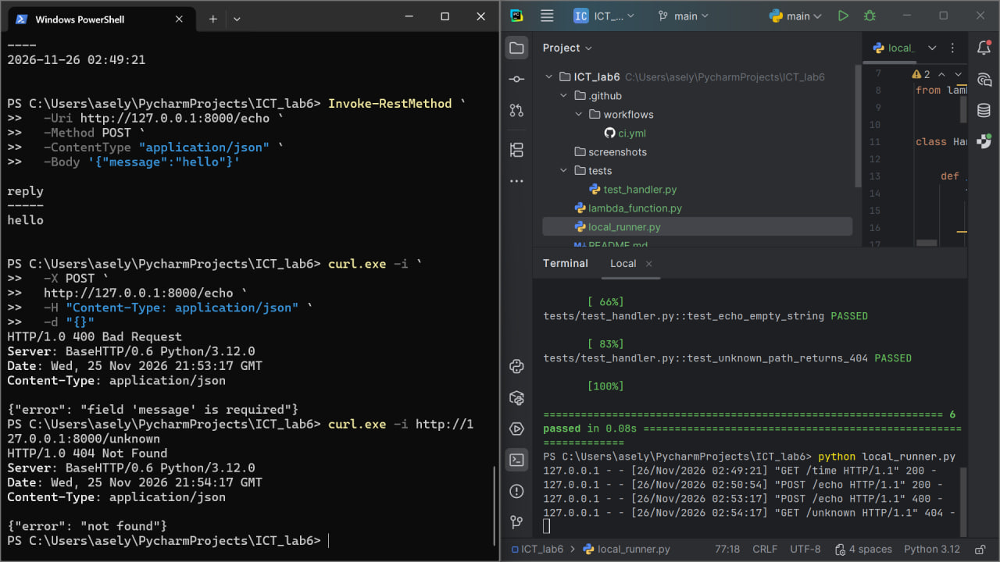
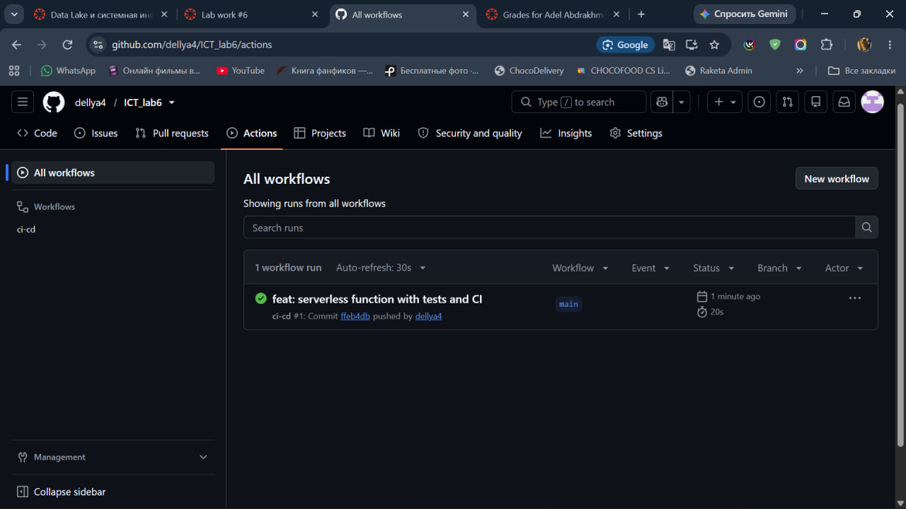
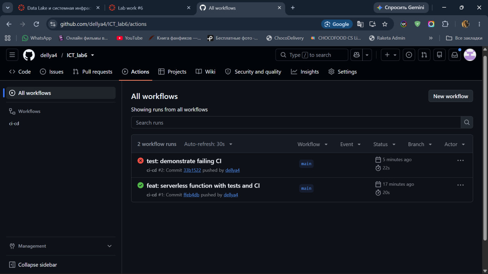
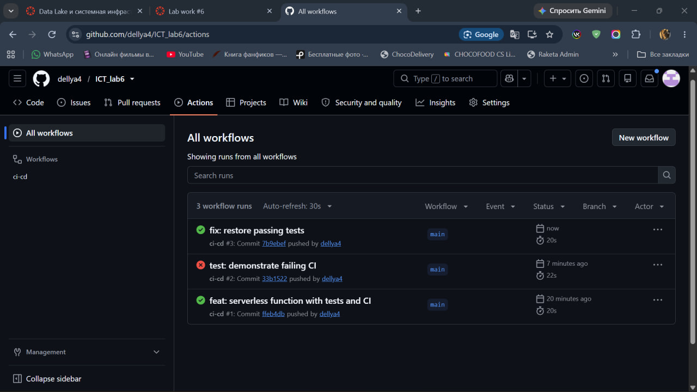
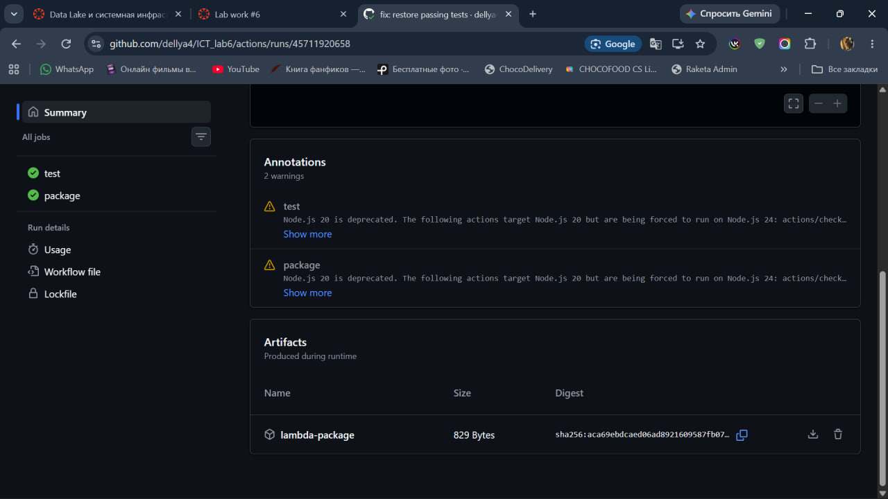

# ICT Lab 6 — Serverless Function and CI/CD

## Project

This project implements a simple serverless function with:

- GET /time
- POST /echo
- 400 error handling
- 404 error handling
- automated pytest tests
- GitHub Actions CI/CD

## Tests

## Local Run

### Time

### Echo

### 400 Error

### 404 Error

## CI/CD

### Successful Pipeline

### Failed Pipeline

### Fixed Pipeline

### Artifact

## Conclusion

The function was tested locally and automatically with pytest.

GitHub Actions runs the tests on every push.

The Lambda package is created only when all tests pass.